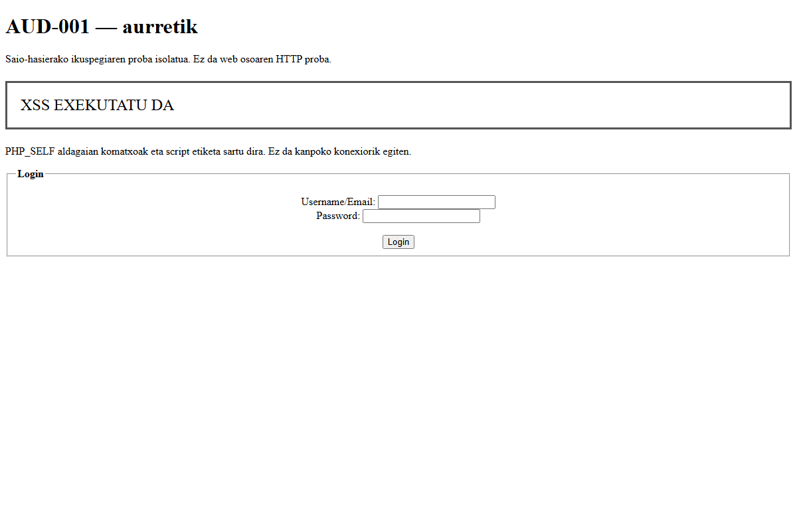
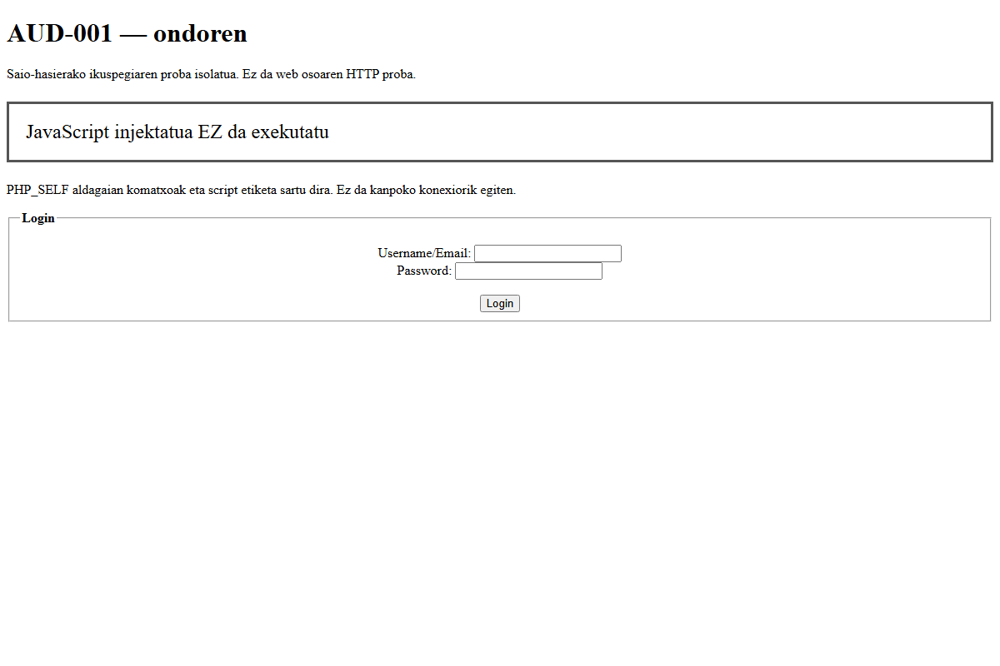

# AUD-001 — Saio-hasierako formularioaren HTML/JavaScript injekzioa

Data: 2026-10-26. Lotutako GitHub issuea: [#11 — XSS ahuleziak zuzentzea](https://github.com/91Adrian91/ERRONKA2_TALDE5/issues/11).

## 1. Zer aztertu dugu?

`erronka2_web/includes/login.php` fitxategiko saio-hasierako formularioaren
`action` atributua soilik. Jatorrizko kodea `8ff97b4` commit-ean dago.
Lan-adarra: `web/WEB-11-login-xss`.

Jatorrizko kodea:

```php
<form action="<?php echo $_SERVER['PHP_SELF']."?action=login"; ?>" method="post">
```

`PHP_SELF` balioa HTML atributuan zuzenean sartzen da. Balioak komatxo bikoitz
bat eta HTML etiketak baditu, `action` atributua itxi eta etiketa berriak sor
ditzake. Zenbait zerbitzari-konfiguraziotan, eskaeraren bideak `PHP_SELF`
balioan eragina izan dezake. Benetako HTTP bidezko ustiagarritasuna
zerbitzariaren bide-tratamenduaren araberakoa da, eta ez dugu oraindik probatu.

## 2. Nola frogatu dugu?

MySQL duen web osoa oraindik ez dago martxan: Docker daemon-a ez zegoen
erabilgarri eta tokiko PHP-k ez du `mysqli` luzapena kargatuta. Horregatik,
formularioaren PHP ikuspegia isolatuta exekutatu dugu. Proba hau **ez da**
benetako eskaera HTTP baten bidezko web osoaren froga.

`tools/login-xss-proof.php` tresnak `PHP_SELF` aldagaian balio hau ezartzen du:

```text
/index.php/"><script>document.getElementById("xss-egoera").textContent="XSS EXEKUTATU DA";</script><span data-x="
```

Proba-mezu honek orriko testu bat baino ez du aldatzen. Ez du cookierik
irakurtzen, ez du daturik bidaltzen eta ez du kanpoko baliabiderik kargatzen.
Tresnak benetako `login.php` fitxategia kargatzen du eta haren irteera HTML
fitxategi batean gordetzen du. HTML hori Chrome headless bidez ireki dugu,
proiektuaren barruko profil bereizi batekin.

### Aurretik

```sh
php tools/login-xss-proof.php aurretik
php vendor/phpunit/phpunit/phpunit --filter testLoginActionDoesNotAllowHtmlInjectionFromRequestPath
```

Komando horiek jatorrizko `login.php` kodearekin exekutatu ziren, zuzenketa
egin aurretik. Sortutako HTMLak `<script>` etiketa bat zuen. PHPUnit-en
erregresio-probak huts egin zuen: 0 script espero zituen eta 1 aurkitu zuen.
Chrome-k script hori exekutatu zuen: adierazleak **XSS EXEKUTATU DA** erakutsi zuen.



## 3. Zer aldatu dugu?

Formularioak helmuga ezaguna duenez, eskaeratik datorren bidea kendu eta
helmuga finkoa jarri dugu:

```php
<form action="index.php?action=login" method="post">
```

Horrela, `PHP_SELF` ez da atributu horretan sartzen. Ez dugu erabiltzaileak
sartutako balioa ezabatzen edo ordezkatzen: formularioaren helmugak ez du
aldagai hori behar. Helmuga erlatiboak webgunearen karpetako `index.php`
erabiltzen du, aplikazioaren ohiko sarrera-bidetik.

OWASPek HTML atributuetan konfiantzarik gabeko balioak sartzea saihestea edo
testuinguruari dagokion kodetzea erabiltzea azaltzen du. Kasu honetan,
helmuga finkoak datu horren beharra kentzen du.
[Erreferentzia: OWASP XSS Prevention Cheat Sheet](https://cheatsheetseries.owasp.org/cheatsheets/Cross_Site_Scripting_Prevention_Cheat_Sheet.html).

## 4. Proba bera berriz

```sh
php tools/login-xss-proof.php ondoren
composer check
```

Sarrera bera erabilita, sortutako formularioaren `action` atributuak
`index.php?action=login` balioa du eta ez dago script injektaturik.
Chrome-ko adierazleak **JavaScript injektatua EZ da exekutatu** erakutsi zuen.
Nabigatzailearen DOM irteeran ere bi adierazleen balioak egiaztatu dira.



PHPUnit-en proba berriak hiru baldintza egiaztatzen ditu:

1. Ez dago `<script>` etiketarik.
2. Formulario bakarra dago.
3. Formularioaren helmuga zehatza `index.php?action=login` da.

`composer check` emaitza: PHP sintaxia zuzena, PHPStan gaindituta eta
**5 proba / 15 baieztapen gaindituta** PHP 8.5.1 bertsioan.

## 5. Zer frogatu da eta zer falta da?

Frogatuta dago jatorrizko ikuspegiak aldagaiaren edukia kode exekutagarri
bihurtzen zuela proba isolatuan, eta zuzenketak puntu hori ezabatzen duela.
Ez da frogatu webgunearen zerbitzari errealak sarrera bera `PHP_SELF`-era
iristen uzten duenik. Ez da saio-hasiera datu-basearekin probatu eta ez dira
beste `PHP_SELF` erabilerak, SQLi, pasahitzak edo saioen kudeaketa zuzendu.

Benetako HTTP proba egiteko, martxan jarri webgunea MySQL-rekin, egiaztatu
zer balio jasotzen duen `PHP_SELF`-ek aldatu gabeko bertsioan eta errepikatu
kasua zuzendutako bertsioan. Zerbitzariak bidea baztertzen badu, emaitza hori
ere dokumentatu: ez ordezkatu isolatutako emaitzarekin. Saio-hasiera arrunta
eta aplikazioaren karpetako formularioaren helmuga ere egiaztatu.

## 6. Ebidentziak eta erreprodukzioa

- [Aurreko HTML irteera](ebidentziak/AUD-001/aurretik.html).
- [Ondorengo HTML irteera](ebidentziak/AUD-001/ondoren.html).
- [Aurreko DOMa, JavaScript exekutatu ondoren](ebidentziak/AUD-001/aurretik-dom.html).
- [Ondorengo DOMa](ebidentziak/AUD-001/ondoren-dom.html).
- [Froga-tresna](../../tools/login-xss-proof.php).
- [Erregresio-proba](../../tests/AuthenticationViewsTest.php).

`aurretik.html` historikoa da: zuzendutako kodearekin tresna berriz
`aurretik` argumentuarekin exekutatzeak fitxategi hori gainidatziko luke eta ez
luke aurreko portaera erreproduzituko. Aurreko egoera errepikatzeko,
`8ff97b4` commit-eko `login.php` erabili aparteko lan-kopia batean.

Capturak Chrome-rekin egindako benetako pantaila-argazkiak dira, HTML irteera
isolatuarena; ez dira web osoaren edo MySQL konexioaren capturak.
